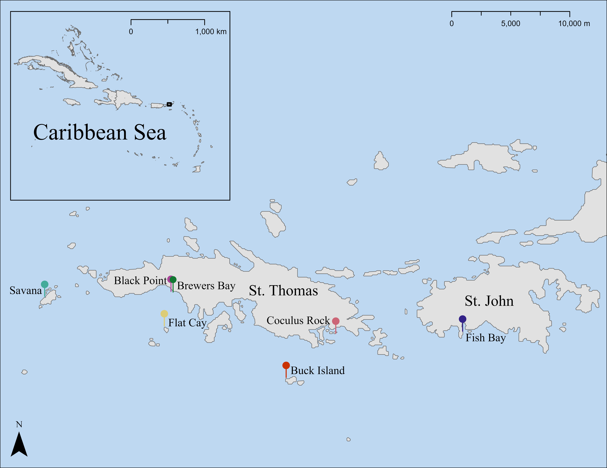

```{r} 
#| echo: FALSE
#| output: FALSE

# Libraries -------------------------------------------------------------

library(MASS)
library(tidyverse)
library(readxl)
library(janitor)
library(stringr)
library(performance)
library(dplyr) 
library(lme4)
library(DT)

source("../Scripts/cleaning_functions.R")
source("../Scripts/Functions.R")

conflicted::conflicts_prefer(dplyr::select)
conflicted::conflicts_prefer(dplyr::filter)
conflicted::conflicts_prefer(dplyr::group_by)

# Data Import -------------------------------------------------------------
fishmeta <- metafish("../Data/Fish Count Data_11_24_26.xlsx")
video <- VideoDataCleaning_time("../Data/Fish Count Data_11_24_26.xlsx", fishmeta)
clipboard <- ClipboardDataCleaning("../Data/Fish Count Data_11_24_26.xlsx", video)
SiteMetadata <- read_xlsx("../Data/Fish Count Data_11_24_26.xlsx", sheet = "SiteMetadata") |> 
  filter(Code != "GKT")
```
# Project Metadata
Data was collected from April 2026 to November 2026 at five different sites listed below. Methods included using waterproof paper and pencils for clipboard surveys, and Hero 13 GoPros for both diver and Rangerbot surveys. 
```{r}
#| echo: FALSE
#| warning: FALSE
SiteMetadata_table <- SiteMetadata |> 
  filter(Code != "BWR" & Code != "FSB")

DT::datatable(
  SiteMetadata_table,
  caption = "Site Metadata",
  extensions = "Buttons",
  options = list(
    pageLength = 80,
    scrollX = TRUE,
    autoWidth = TRUE,
    dom = "Bfrtip",
    buttons = c("copy", "csv", "excel")
  )
)
```
## Site Map
{.lightbox fig-align="center"}


# Abundance Analyses 
The following graphs and statistical analyses were performed incorporating data from all five sites. Only data with sites that have a full comparison set (clipboard survey, diver video, Rangerbot video) were used.  
```{r}
#| echo: FALSE
#| warning: FALSE

# Calculating Abundance
species_abundance <- abundance_df(clipboard, video, TransectID, SurveyLocation, SurveyDate, C_D_R, Visability, TotalDuration_min) |> 
  mutate(
    abund_per_min = total_abundance/TotalDuration_min
  )

# Selecting only transects that have a full C_D_R comparison
comp_abundance <- species_abundance |> 
  group_by(TransectID) |> 
  filter(n() == 3) |>
  ungroup()

comp_abundance <- comp_abundance |> 
  select(TransectID, SurveyDate, Location, C_D_R, Visability, total_abundance, abund_per_min) |> 
  mutate(
    SurveyDate = format(SurveyDate, "%m/%d/%Y"))
```

```{r}
#| echo: false
#| output: asis
cat("
<details>
<summary><strong>Show Data Used</strong></summary>
<br>
") 
# Data frame used to make the following graphs
DT::datatable(
  comp_abundance,
  caption = "Data used to generate Figure 1",
  filter = "top",
  extensions = "Buttons",
  options = list(
    pageLength = 25,
    scrollX = TRUE,
    autoWidth = TRUE,
    dom = "Bfrtip",
    buttons = c("copy", "csv", "excel")
  )
)

cat("</details>")
```
::: {.panel-tabset}

### Abundance 
explain ehy doing and what variables of choice
code
graph of results
main takeaways of results 

```{r}
#| warning: false
#| echo: false
# Boxplot Graph
ggplot(comp_abundance, aes(x = C_D_R, y = total_abundance, fill = C_D_R)) + 
  geom_boxplot() +
  scale_x_discrete(
    labels = c(
      "C" = "Clipboard",
      "D" = "Diver",
      "R" = "Rangerbot"))+
  labs(
    x = "Survey Method",
    y = "Fish Abundance")+
  theme_minimal()+
  theme(
    axis.text.x = element_text(size = 12),
    strip.text = element_text( size = 12),
    axis.text.y = element_text(size = 12),
    axis.title = element_text(size = 15),
    plot.caption = element_text(size = 10),
    plot.title = element_text(size = 20)
  )

```
**Fig. 1:** The distribution of total fish abundance across different survey methods. 

### Trophic Level

```{r}
#| warning: false
#| echo: false
relative_abund(TrophicLevel, "Trophic Level")
```


### Species
```{r}
#| warning: false
#| echo: false
relative_abund(ScientificName, "Species")
```

### Family
```{r}
#| warning: false
#| echo: false
relative_abund(Family, "Family")
```

### Normalized to Time
```{r}
#| warning: false
#| echo: false
# Boxplot Graph
ggplot(comp_abundance, aes(x = C_D_R, y = abund_per_min, fill = C_D_R)) + 
  geom_boxplot() +
  scale_x_discrete(
    labels = c(
      "C" = "Clipboard",
      "D" = "Diver",
      "R" = "Rangerbot"))+
  labs(
    x = "Survey Method",
    y = "Fish Abundance per Minute")+
  theme_minimal()+
  theme(
    axis.text.x = element_text(size = 12),
    strip.text = element_text( size = 12),
    axis.text.y = element_text(size = 12),
    axis.title = element_text(size = 15),
    plot.caption = element_text(size = 10),
    plot.title = element_text(size = 20)
  )
```
**Fig. 2:** The distribution of fish abundance normalized to time (min) across different survey methods.
:::

# Richness Analyses

