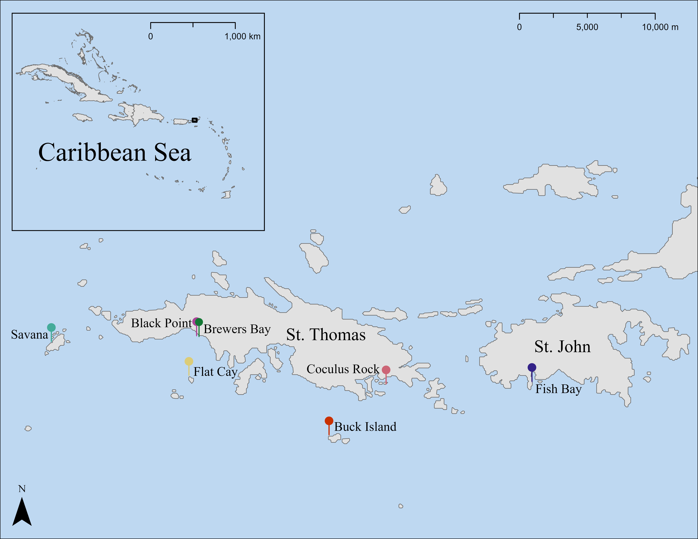

## Analysis 
::: {.panel-tabset}
### Abundance 
explain ehy doing and what variables of choice
code
graph of results
main takeaways of results 

### Richness 

### Trophic Level 
:::

# Site Map
{.lightbox fig-align="center"}
Citation [@cite]
